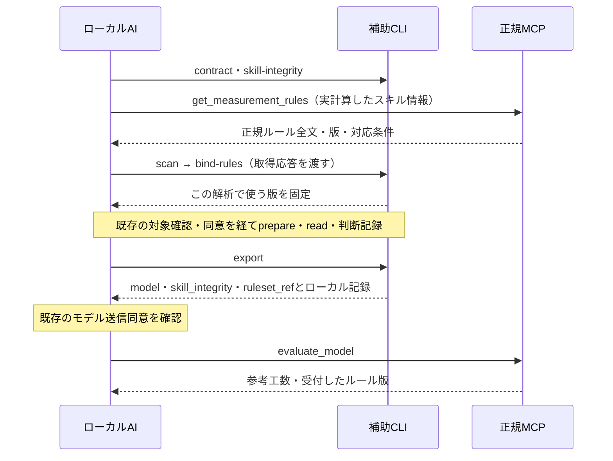

# 測定ルールのサーバー一元管理：改善仕様書

作成日：2026-10-19（JST）

状態：実装前の仕様。実装・本番反映・実機検証の完了を意味しない。

実装指示：[CENTRAL-MEASUREMENT-RULES-IMPLEMENTATION.md](CENTRAL-MEASUREMENT-RULES-IMPLEMENTATION.md)

先行仕様：[スキル整合性の申告確認](SKILL-INTEGRITY-IMPLEMENTATION-PLAN.md)

## 1. 目的と基本方針

測定ルールの原本を一か所で管理し、正規MCPから利用時に配信する。ローカルのSKILL.mdは、実行条件、接続先、取得・確認・呼出しの手順に絞る。既存のスキルハッシュ照合は維持し、「入口となるローカルスキルの整合性」と「使用する測定ルール」を別々に確認する。

企業に提供する価値は、共通のルールを配布できること、いつのルールを使用したか説明できること、ルール更新のたびに端末上のプラグインを入れ替えずに済むこととする。企業別設定画面、承認フロー、第三者認証は追加しない。

初回は新方式に対応したプラグインへの更新が一度必要。その後、既存の入力形式・計数エンジンと互換なルール本文の変更は、サーバー更新で反映できる。新しいCLI機能やSchema変更が必要な更新は通常のプラグイン更新と区別する。

本方式もAIが取得・適用手順に従う前提を持つ。MCPの返却文にホストのシステム指示を上書きする権限はない。受領した版の確認を、AIがそのルールで実際に解析したことの証明として扱わない。

## 2. 確認した現状と変更の境界

2026-10-19の作業ツリーではpackage.jsonは0.6.0であり、ハッシュ照合・統合リリースに関する未コミットの変更が存在する。以下はコードを読んだ結果で、本番デプロイやテスト成功の確認ではない。実装開始時に最新差分を再確認すること。

| 現状 | 本仕様で追加・変更すること |
| --- | --- |
| SKILL.mdに起動手順、測定原則、v2判断記録、報告方法がまとまっている | 起動手順と測定ルールを分離し、後者をサーバー配信へ移す |
| get_skill_policyとcheckSkillIntegrityが存在する | その照合を再利用し、get_measurement_rulesを追加する |
| CLIがscan時のスキル値を保持しprepare／exportで再確認する | 解析セッションに取得ルールの版と本文を固定する |
| evaluate_modelは数値モデルを検査してサーバーで再計算する | ruleset_refの受付可否・互換性を毎回検査する |
| release-plugin.mjsが候補固定、デプロイ、実接続確認、配布昇格を行う | 共通処理を利用し、ルールだけを更新する経路を追加する |

本仕様では測定式、CFPの重複排除規則、TEST工数係数、賃金、為替処理を変更しない。初回のルール分離は意味を変えない移植とする。既存の未コミット変更を巻き戻して作り直さない。

先行のハッシュ照合計画から、実ファイル計算・両コピー照合・評価前の検査・公開の自動化を引き継ぐ。変更後のスキルハッシュは短縮した入口スキルと同梱スクリプトを対象とし、サーバーから取得するルール本文は別のrevisionで管理する。ルール本文をスキル配下へ生成し直して、本文更新のたびにスキルハッシュまで変わる構造にはしない。

## 3. 手間を増やさないための要件

| 利用者・運用者 | 必要な操作 | 自動処理 |
| --- | --- | --- |
| 見積利用者 | 従来どおり見積を依頼し、対象と送信内容を確認 | 正規ルール取得、版固定、保存、提出時の照合 |
| ルール管理者 | 原本を編集し、通常のリリース操作を実行 | 改訂ID、ハッシュ、規則ID一覧、履歴、サーバー配布物の生成 |
| プラグイン管理者 | 初回対応版やCLI機能変更時だけ通常更新 | ローカルスキルとルールの互換性検査 |

ルール変更ごとのハッシュ転記、版番号の手採番、顧客別登録、端末登録、追加同意画面を設けない。取得・照合のための利用者への質問は追加せず、既存の送信説明に追加メタデータを含める。

## 4. 原本と生成物

| パス（新規予定） | 役割 | 通常の手編集 |
| --- | --- | --- |
| `rules/measurement/source.md` | 測定原則・判断記録・報告ルールの唯一の原本 | ここを編集する |
| `rules/measurement/contract.json` | ルールID、配信形式、対応するCLIプロトコル・Schema・エンジンの宣言 | 対応機能が変わる時だけ |
| `profiles/measurement-rules.json` | 過去の不変bundle、受付状態、新規解析向けcurrentを保持する生成履歴 | 通常は編集しない |
| `skills/open-estimate-assessor/SKILL.md` | ローカルの短い起動・取得・確認手順 | 手順自体が変わる時だけ |

Workerは生成済みルール履歴を同梱して配信する。新しいDB、KV、管理サーバー、署名鍵は追加しない。履歴はリポジトリで保持し、候補生成物だけを消しても失われないようにする。

生成履歴の構造は次を基準とする。初期状態はcurrent_revision=null、revisions空配列とし、公開準備で有効な値へ確定する。候補と公開済みの区別はリリース記録で管理し、実行時の状態を二重に持たない。

```text
format: oes/measurement-rules-registry/v1
rules_enforcement_at: <初回移行期限のUTC日時、未設定時はnull>
current_revision: <新規解析向けrevision、未初期化時はnull>
revisions:
  - revision: <bundleから計算した64桁>
    status: available | withdrawn
    bundle: <その版の不変bundle>
```

currentはavailableな登録版を指すこと。withdrawnの本文も履歴から削除せず、通常生成による再有効化を禁止する。revisionの重複、本文hash不一致、current参照切れは起動テストと公開準備で拒否する。

### 4.1 原本から移す内容

| 現SKILL.mdの内容 | 移行先 |
| --- | --- |
| Node・ローカル権限・正規MCP・CLIの起動方法 | 短縮したSKILL.md |
| 対象確認、読取同意、送信同意、秘密情報を送らない境界 | SKILL.md／既存CLI。ルール本文へ責任を移さない |
| as-built、アプリ境界、機能統合・分割、E/X/R/W、重複の扱い | source.md |
| scope、候補、data_group、judgments、findings、比較の記録方法 | source.md |
| COMPLETE／PARTIAL、未確定と0の区別、報告の順序、TEST値の説明 | source.md |
| キャッシュ期限、purge、失敗時の再開方法 | SKILL.md／CLI contract |

原本内の規範的な節に安定したID（例：`OES-SCOPE-001`）を付け、生成処理が一覧を抽出する。ID一覧を別ファイルへ手で重複記入しない。外部標準の条項番号を創作しない。初回移行時に旧文言との対応表を作り、意味の追加・削除を確認する。

### 4.2 改訂ID

bundleは`format`、`ruleset_id`、`compatibility`、`instructions_markdown`、`rule_ids`を持つ。改訂IDはこれらのJCS表現のSHA-256とし、64桁の小文字16進数を用いる。時刻、公開状態、取得時刻は計算対象に入れない。

原本は生成時にUTF-8、BOMなし、LFへ統一し、統一後の本文を配信する。同じ原本とcontractからは同じbundle・改訂IDになる。既存のローカルスキルの「実バイトを検査する」ハッシュ規則とは別の規則であり、混用しない。

利用者には版の短縮表示を使ってよいが、通信と記録には完全なIDを保持する。本文の誤字修正も新しい改訂となる。同じ改訂IDの本文の上書きは禁止する。

### 4.3 版と互換性の分離

| 識別子 | 意味 |
| --- | --- |
| skill_version／package_sha256 | インストールされた起動スキル・補助処理の配布版 |
| ruleset_id／revision | 解析時に取得した測定ルールの版 |
| client_protocol | CLIが対応するルール取得・固定・提出の通信仕様 |
| engine_contract_id | サーバー計数処理との互換性。初期値は既存の`oes-cosmic-ph1-v1` |
| profile_set_id | TEST工数・賃金の換算基準。測定ルールの版と混ぜない |

初期のclient_protocolは`oes/measurement-client/v1`、Assessmentはv2、数値モデルは`oes/remote-model/v1`とする。プロトコル能力は正規リリース情報にも保持し、クライアントの宣言だけで未対応版を対応扱いにしない。

ルールだけの公開でSchemaや計数方式を変更しない。対応機能の追加が必要な場合は通常リリースへ分ける。自然言語の変更が計数に影響しないかは通常のレビューと回帰例で確認し、自動判定済みとは説明しない。

## 5. MCP契約

### 5.1 get_measurement_rules

要求フィールドは`skill_integrity`、`client_protocol`、任意の`ruleset_ref`。任意URL、対象パス、ソースコード、自由記述を受け付けない。ルールIDは`oes-measurement`に固定する。

- ruleset_ref省略：新規解析向けcurrentを返す。
- ruleset_ref指定：その版が受付中で互換なら、その版を返す。未知・停止・不一致なら拒否する。
- 古いクライアントへ最新非互換ルールを渡したり、黙って古い版へ切り替えたりしない。
- 現行のcheckSkillIntegrityを必ず使用し、新方式でLEGACY_UNCHECKEDを通過させない。

成功応答の構造：

```text
format: oes/measurement-rules-response/v1
ruleset_ref: { ruleset_id: oes-measurement, revision: <64桁> }
bundle:
  format: oes/measurement-rules/v1
  ruleset_id: oes-measurement
  compatibility: { client_protocol, assessment_format, model_format, engine_contract_id }
  instructions_markdown: <原本から生成した全文>
  rule_ids: <本文から抽出した規則IDの配列>
skill_integrity: <サーバーの照合結果>
```

返すのは一つの版の全文と必要なメタデータだけとし、全履歴の本文を返さない。初期上限は本文UTF-8で64KiB、応答JSONで128KiBとし、超過時は公開準備で停止する。応答の途中省略や分割配信は初期実装に含めない。

CLIのcontractは起動手順とSchemaを返し、測定ルール全文を重複して返さない。ツール応答のtext／structuredContentは同じ内容を表し、別々の版を混ぜない。ホストで全文を取得できない場合は解析開始条件を満たさない。

### 5.2 evaluate_model

既存の`model`、`display_currency`、`skill_integrity`に`ruleset_ref`を追加する。数値モデル本体の形式は変更しない。新方式の正規クライアントではruleset_refを必須とし、サーバーで登録・状態・互換性を毎回確認する。

過去にget_measurement_rulesを呼んだというトークンや履歴は要求しない。全ての評価要求で同じ判定関数を通し、直接呼出しでも欠落・未知・停止・非互換を検知する。APIの呼出し順を守ったことや、本文を読んだことの証明とはしない。

`assurance.measurement_rules`へ次を返す。

- `status: ACCEPTED_CLIENT_REPORTED`
- 受付した`ruleset_ref`
- `application: NOT_INDEPENDENTLY_VERIFIED`
- 「申告された測定ルールの版を確認。AIによる適用の正確性は独立検証していません」

既存のreport_hashは数値model・profile・reportに対する値として維持する。追加する`evaluation_context_hash`は`JCS({domain: "oes/evaluation-context/v1", report_hash, ruleset_ref})`のSHA-256とし、数値結果と申告ルール版の対応を示す。署名や実行証明とは表示しない。

旧方式の移行期間中にruleset_refがない場合は`LEGACY_LOCAL_RULES`、ruleset_refとevaluation_context_hashはnullとする。現在の版を補って中央ルール適用済みにしない。

## 6. ローカルの処理と保存



### 6.1 固定と変更検知

新規CLI`bind-rules`はroot、session_id、get_measurement_rulesの成功応答を受け取る。構造、上限、本文からの改訂ID再計算、対応プロトコル、スキル照合情報との一致を確認して、セッションへbundleを保存する。ネット送信は行わない。

scan後、confirm前でも実行できるようにする。既存CLIの「confirm前は全コマンド拒否」の分岐をそのまま適用しない。bind-rulesは測定対象の本文を読み取らない。prepare前までに固定が済んでいなければ`RULESET_NOT_BOUND`で停止する。

同じ版の再bindは冪等。異なる版への再bindは禁止し、新しい解析セッションを使う。prepare、read、exportで固定済みbundleのハッシュを再確認する。ルールの改変・破損は検知して停止する。purgeや下書きの救出は可能にする。

ルール応答をローカルで検査すること自体も、サーバー取得の実行証明ではない。改竄されたローカル処理による偽装を完全に排除したとは扱わない。

### 6.2 判断記録と評価記録

本改修では既存Assessmentの形式を変更しない。OESの規則を参照する`judgments[].rule`は、既存の`source: skill`を互換用ラベルとして維持し、idに配信本文の規則ID、versionにrevisionを記録する。ここでのskillは「OESから提供された測定規則」を意味し、ローカルのSKILL.md本文という意味に限定しない。

新方式のexportでは、source=skillの参照が固定bundle内のID・revisionと一致することを検査する。project_policy／external_standardは従来の扱いを維持するが、OESの規則を変更できる権限とはしない。根拠の妥当性を文字列一致だけで証明しない。

既存のAssessment JSONとassessment_hashは保持し、別ファイルとして以下を生成する。

```text
domain: oes/local-measurement-context/v1
assessment_hash: <既存Assessmentのhash>
ruleset_ref: <固定した版>
bundle: <取得したルール全文と対応条件>
context_hash: <上記4項目のJCSのSHA-256>
```

ファイル名はcontext_hashを含む内容アドレスとし、同じAssessmentに別の版が関連しても上書きしない。同じ内容の再保存は冪等、既存ファイルの内容不一致はエラー。取得日時を保存する場合はhash対象外のメタデータとして明確に分ける。

exportはこのcontextのローカルパス、ruleset_ref、model、skill_integrityを返す。既存Assessmentへのルール版の後付けや旧hashの変更は行わない。新規判断のversionを変更した結果Assessmentのhashが変わることは正常である。

保存期間は既存の24時間セッションとpurgeに従う。長期保管が必要な場合は既存の評価記録の保存案内で、Assessmentとcontextを一緒に保持するよう示す。永続的な企業監査台帳を提供したとは説明しない。

### 6.3 更新・障害・再計算

- 新しいセッションはcurrentを取得する。進行中のセッションは固定版を使い、更新のたびに中断させない。
- currentが変わっても、受付中の旧版なら評価を受理する。
- 途中で固定版が停止された場合は評価を拒否する。黙って最新版へ差し替えず、新版での再解析を案内する。
- 初回取得に失敗した場合は解析を開始しない。ローカルの古い本文や会話の記憶へフォールバックしない。
- 取得済みセッションは既存TTL内で同じ版を使える。最終評価は必ずサーバーに接続し、その時点の受付状態を確認する。
- コンテキストが圧縮された場合はローカル保存した固定bundleを読み直す。破損・欠損時に再取得する場合も同じruleset_refを指定し、最新へ切り替えない。
- 過去モデルの再計算は保存済みのruleset_refを使う。生成時の版が不明なら現在版を推定せず、移行期限後は新版による再解析を案内する。

## 7. エラーと情報境界

| コード | 条件・対応 |
| --- | --- |
| `RULESET_REQUIRED` | 新方式または移行期限後に版がない。正規手順で取得・解析する |
| `RULESET_UNKNOWN` | 未登録のID・revision。別の版へ自動変更しない |
| `RULESET_WITHDRAWN` | 明示停止した版。新版で再解析する |
| `RULESET_INCOMPATIBLE` | CLI・Schema・計数処理との対応不一致。対応プラグインへ更新する |
| `INVALID_RULESET_REF` | 版の書式不正・未知フィールド |
| `RULESET_NOT_BOUND` | prepare前に固定されていない |
| `RULESET_CHANGED` | セッションのbundle破損・変更・異なる版への再bind |
| `RULE_REFERENCE_MISMATCH` | 判断記録のOES規則ID・版が固定ルールと異なる |
| `RULESET_UNAVAILABLE` | 配信側に有効なcurrentがない。運用側で配信を復旧する |

リモート拒否はisError=trueと構造化codeで返し、計算結果は含めない。全エラーに「スキルを再インストール」と一律案内せず、ルール取得・サーバー復旧・再解析・互換版更新を区別する。

送信するのは既存数値モデル、表示通貨、スキル情報、ruleset_refのみ。ルール取得要求にも対象ソースや対象パスを含めない。公開ルール本文はサーバーから受け取り、利用者のソース、Assessment、判断台帳、ローカルcontextは送信しない。スキル本文のサーバーアップロード方式は採用しない。

正規MCPの接続先は既存の固定先を使う。リポジトリ本文やルール本文に埋め込まれた別URLへ切り替えず、リモートから取得したコードを実行しない。ホストの上位指示・利用者の許可・秘密情報の扱いと矛盾する場合は停止して報告する。

## 8. 更新・公開・互換性の運用

### 8.1 ルールだけの更新

通常操作は「source.mdを編集 → `npm run rules:release`」とする。このコマンドは本仕様で追加するもので、作成時点では未実装。

自動処理は、原本検査 → bundle・revision生成 → 履歴を保持した候補生成 → 関連テスト → Worker固定 → デプロイ → 本番で全文・revision・互換性・評価の確認 → リリース記録の保存、とする。公開せず確認する`rules:prepare`と、固定候補を再開する`rules:publish`も用意する。

ルールだけの更新ではpackage.json、plugin.json、skill.manifest.json、配布先プラグインを更新しない。スキルの受付履歴と既存の必須化日時を保持する。ハッシュ値やrevisionを人に入力させない。

同じ原本の再実行では改訂を増やさない。公開済み履歴の欠落、同一revisionへの別内容、停止情報の消失を検知して公開を止める。中断後は同じ固定候補から再開し、公開時に再ビルドしない。

### 8.2 通常リリースとの共有

初回対応やCLI変更は既存`release`の候補に、プラグイン・スキル受付リスト・測定ルール履歴・Workerを一緒に固定する。サーバー確認後にプラグインを昇格する既存順序を維持する。

通常リリースとrules:releaseは同じ排他ロックと履歴検査を使う。prepare後に別リリースで受付・停止・currentが変わった候補は公開を拒否し、新候補を生成する。古い候補によるルールやスキル登録の巻き戻りを防ぐ。

ルール本文、対応条件、current、受付状態は同じWorkerへ同梱し、一回のデプロイで切り替える。現在版を別の設定値で先に切り替えない。既存のスキル移行日時をランタイム設定で渡す場合も、ルール公開で消さない。

### 8.3 旧版と初回移行

初回対応プラグインの公開から14日間を旧方式の移行期間案とする。既存スキルの移行期限とは別に`rules_enforcement_at`を持ち、初回公開処理で自動設定し、通常更新では延長しない。

正規リリース情報にclient_protocol対応を保持する。新方式対応版は初日からruleset_ref必須。旧方式版だけ、既存スキル検査を通ったうえで期間中に限り版なし再計算を許し、LEGACY_LOCAL_RULESを返す。新方式クライアントが申告を省略して旧方式へ降格することは認めない。

旧版の表示が新メタデータを反映するかは実機確認対象であり、全旧クライアントが警告を確実に表示するとは保証しない。期間後の欠落は拒否する。過去評価のルール版を中央配信版と偽って補完しない。

初回サーバー反映後に配布昇格が失敗した場合は、同じ候補で再開する。初回配布可能日から十分な移行期間が残ることを公開処理で確認する。新規解析のcurrentを選べない未初期化状態では成功を返さない。

### 8.4 停止と復旧

通常更新では旧版を削除せず、受付中の固定版の解析を継続できるようにする。重大な誤りがある版だけ例外操作でwithdrawnにする。新規解析を前の安定版へ戻す場合も、履歴を削除せずcurrentを切り替える新しい配信候補を作る。

Workerコードを戻す場合も、現在の受付・停止履歴を保持する。古いWorker成果物の直接復元を通常手順にしない。停止・current切替は既存リリース処理の管理モードとして実装し、新しい管理画面は作らない。

## 9. 保証する範囲と対象外

提供するのは、共通原本の配信、版の固定、申告された版の受付確認、機械的に検査可能な数値モデルの検査・再計算、使用版のローカル記録である。AIの意味解釈の正しさ、正規ルールの実際の適用、機能抽出の網羅性、実工数を保証しない。

対象外は、顧客別の測定規則、管理画面、SSO、承認ワークフロー、ルールの自動生成・自動承認、ソースのサーバー解析、AI呼出しの追加、署名・端末認証、評価保存API、企業監査台帳、証明書発行とする。

## 10. 完了条件

実装完了の判定は実装指示書の受入表に従う。少なくとも、原本一か所からの生成、互換なルールだけの更新でプラグイン不変、解析中の版固定、ルール欠落・不一致の拒否、過去評価の非改変、公開失敗からの再開を自動試験で確認する。

本番配信とWork／Codexでの実機確認は別に記録する。自動テスト成功だけで「全利用者が正規ルールで解析している」「改竄を防止できる」と結論しない。
