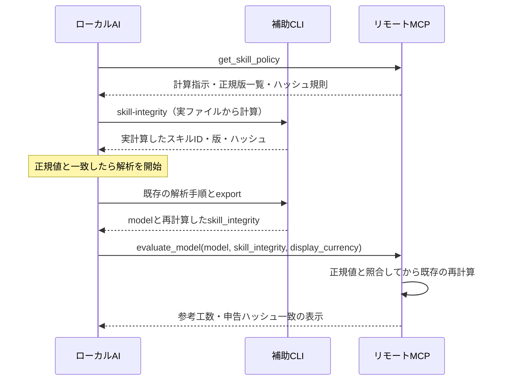

> **仕様整理（2026-10-28）**：構成・責務・利用フローは[新システム仕様](SYSTEM-SPEC.md)を基準とします。本書は従来の実装・検証・個別技術の参考資料です。Web保存必須、表示時の再計算、認証との結合等の旧前提は新規設計へ適用しません。本書の合格記録は新仕様の受入完了を意味しません。

# スキル整合性の申告確認とリリース自動化：実装計画

作成日：2026-10-19（JST）  
状態：実装計画。本文の追加機能・コマンド・検証は未実装。  
対象：現行のWork／Codex向けプラグイン、補助CLI、HTTPリモートMCP。  
前提：自己申告に基づく参考見積。第三者認証・ソース監査を目指さない。

## 1. 目的と採用方針

ローカルAIがMCPの指示に従って実ファイルのハッシュを計算・申告することを前提に、変更されたスキルや配布物の混在を検知する。サーバーは自ら保有する正規ハッシュと照合し、不一致の場合は参考工数の再計算を進めない。

正規ハッシュは、配布物の作成時に自動生成し、MCP Workerへ同梱する。利用者から申告された未知のハッシュを正規値として登録する機能は設けない。

メンテナンスの基本要件は次のとおり。

- 管理者はスキルを修正し、通常のリリース操作を行うだけとする。
- ハッシュの手計算、コピー、サーバー管理画面への登録を不要にする。
- バージョンの管理元を`package.json`へ集約し、スキルmanifest・プラグインmanifestの版は自動で同期する。
- 配布物とサーバー用照合リストを同一リリースから生成し、サーバー反映の確認後に配布可能とする。
- 新版の追加で既存の正常な配布版を直ちに無効化しない。

これは「スキルの改竄を検知する軽量な対策」である。正規値の偽装申告、別の指示による解析、AIの意味解釈の誤りを防ぐ認証機構ではない。署名、端末認証、実行証明、認証用DBは追加しない。

## 2. 現行実装から確認した事項

以下は2026-10-19のリポジトリ確認結果。本番環境の状態を再確認したものではない。

| 対象 | 現行の動作 | 本計画での変更 |
| --- | --- | --- |
| `src/profiles/skill-package.ts` | `hashSkillPackage()`がスキル配下の実バイトをハッシュ化。manifest自身を除外し、ファイル一覧をJCS化して集約 | 計算規則を再利用する |
| `scripts/update-skill-manifest.mjs` | build時にmanifestを自動生成。版は現在`0.5.0`の固定文字列 | 版を`package.json`から取得する |
| `src/mcp/tools/get-assessor-contract.ts` | ローカルのスキル実体とローカルmanifestを照合 | 既存検査を維持。リモートでの正規値照合を追加する |
| `scripts/package-plugin.mjs` | `skills/`と`server/skills/`にコピーを配置。配布側のハッシュ検査あり | 両コピーとサーバー照合リストの一致を検査する |
| `skills/open-estimate-assessor/scripts/oes.mjs` | 配布場所から補助CLIを起動 | AIが実際に読むスキルのルートをCLIへ渡す |
| `src/local/cli.ts` | contract・解析補助・exportを提供。exportは送信しない | 実ファイルのハッシュ計算、開始時とexport時の一致検査を追加 |
| `src/remote/worker.ts` | `evaluate_model`を公開するステートレスなHTTP MCP | ポリシー取得ツールを追加する |
| `src/remote/model.ts` | 受領した数値モデルを検査・再計算。スキル情報は未受領 | 各評価リクエストでスキルの申告値を照合する |
| `package.json` | build、plugin:pack、deploy:mcpは独立した操作 | 一連のリリース処理を統合し、未登録配布を防ぐ |

特に、配布物のAI向け`skills/open-estimate-assessor/`と、CLI内部が参照する`server/skills/open-estimate-assessor/`を区別する。後者だけが正常でも、前者が変更されていれば本対策は機能しない。

## 3. 検査範囲とハッシュ規則

### 3.1 検査対象

AIにロードされた当該プラグインの`skills/open-estimate-assessor/`を基準とし、配下の全通常ファイルを検査する。現在は`SKILL.md`と`scripts/oes.mjs`が主対象。将来追加する規則・テンプレートも自動で含める。

`skill.manifest.json`は自己参照を避けるため集約対象から除外する。ただし、manifest内のID・版・ファイル一覧・集約ハッシュと実計算結果の整合は別途検査する。manifestを書き換えても、サーバーの正規値は変わらない。

対象ソースコード、ユーザーの設定、Assessment、キャッシュ、ローカル絶対パスは検査結果として送信しない。`server/dist`や全依存ライブラリまでを本対策の検査対象に拡張しない。

### 3.2 計算方法

既存の`oes/skill-package/v1`を維持する。

1. 各ファイルの実バイトからSHA-256を計算する。改行や文字コードを実行時に正規化しない。
2. ルートからの相対パスを`/`区切りにし、既存実装と同じ順序で並べる。
3. `{domain: "oes/skill-package/v1", files: [{path, sha256}, ...]}`をJCS化し、SHA-256を計算する。
4. symlink、読めないファイル、必須ファイル欠損はエラーとする。未知の追加ファイルも集約に含めるため不一致になる。

正規値の元は最終配布物のバイト列とする。パッケージ後の改行変換・ファイル差し替えは禁止し、配布候補の検査後に再生成した場合は検査からやり直す。

## 4. 評価時の処理



### 4.1 サーバーからの指示

新規ツール`get_skill_policy`は引数`{}`で呼び出し、次を返す。

- `policy_version: "oes/skill-integrity-policy/v1"`
- `hash_rule: "oes/skill-package/v1"`
- 最新の推奨版、受け付けるスキルID・版・ハッシュ一覧、照合リストの内容ハッシュ
- 初回移行時の必須化日時（第8節）
- 実ファイルからの計算を求める指示と、正規版への更新案内

指示文の要旨：

> 今回使用するスキルの実ファイルからハッシュを計算してください。manifestやこの応答に記載された正規ハッシュを申告値として転記しないでください。不一致の場合は解析を進めず、正規配布版への更新を案内してください。export時にも再計算し、その結果を評価リクエストへ含めてください。

正規ハッシュは秘密ではない。取得ツールの呼出し履歴やトークンによって正直な実行を証明しようとはしない。

### 4.2 ローカル計算

新規CLIコマンド`skill-integrity`はネットアクセスせず、実計算結果を返す。通常のプラグイン起動では`oes.mjs`自身の位置からスキルルートを導出し、CLIへ内部引数で渡す。カレントディレクトリや評価対象リポジトリからスキルを探索しない。

配布版ではAI向けスキルと`server/skills`の両方を計算し、一致を確認する。開発版の直接CLI起動ではリポジトリのスキルを使い、未登録ハッシュをリモートで自動承認しない。期待するルートが決まらない場合は推測せずエラーにする。

開始時の結果をローカル解析セッションに保持する。`prepare`で実ファイルを再確認し、`export`で再計算して開始時と比較する。途中変更を検知した場合は`SKILL_CHANGED_DURING_ANALYSIS`として止め、正規版で新しい解析セッションを開始するよう案内する。読み込み済みの指示と実ファイルの一致が不明な更新後は、新しいチャットで開始する。

`export`は既存の`model`に加え、送信用の`skill_integrity`を別フィールドで返す。Assessment中の自己申告ハッシュやmanifest値をそのまま複製せず、実計算結果を使う。exportがネット送信しない既存の動作は維持する。

### 4.3 評価リクエスト

追加するフィールドの形式案：

```json
{
  "skill_integrity": {
    "format": "oes/skill-integrity/v1",
    "skill_id": "open-estimate-assessor",
    "skill_version": "<配布版>",
    "hash_rule": "oes/skill-package/v1",
    "package_sha256": "<実ファイルから計算した64桁の小文字16進数>"
  }
}
```

上記は形式の説明用であり、プレースホルダーを実リクエストに使用しない。既存の`model`・`display_currency`と同じ階層に置く。`model.version`は`oes/remote-model/v1`のまま維持し、外側の入力契約を改訂する。

スキルID・hash_rule・formatは定数、版は長さ上限と書式、ハッシュは64桁の書式を検査する。未知フィールドは拒否する。ファイル一覧や自由記述は送らない。

`evaluate_model`は毎回、サーバー同梱の照合リストと照合する。事前ツールを省略して直接呼び出しても検査される。クライアントからの`verified: true`や「先ほど確認した」という主張は受け付けない。

### 4.4 結果とエラー

既存の`assurance`に`skill_integrity`を追加する。照合成功は`status: "MATCHED_CLIENT_REPORTED"`とし、照合したID・版・ハッシュ・ポリシー版を返す。`source_audit: "NOT_INDEPENDENTLY_VERIFIED"`などの既存表示は維持する。

利用者向け表示は「正規配布版との申告ハッシュ一致を確認。解析内容の正確性は独立検証していません」とする。「改竄不能」「認証済み」「実行証明済み」とは表示しない。

| エラーコード | 条件 | 利用者への案内 |
| --- | --- | --- |
| `SKILL_INTEGRITY_REQUIRED` | 必須化後に申告がない | 正規最新版で実ファイルを検査して再実行 |
| `INVALID_SKILL_INTEGRITY` | 書式不正・未知フィールド | 正規CLIの出力を使用 |
| `SKILL_VERSION_UNSUPPORTED` | ID・版・規則が未登録 | 配布版を更新。未知の値を自動登録しない |
| `SKILL_INTEGRITY_MISMATCH` | 登録版に対してハッシュ不一致 | 再インストールし、新しい解析を開始 |
| `SKILL_VERSION_REVOKED` | 明示的に停止した配布版 | 利用可能な配布版へ更新 |
| `SKILL_CHANGED_DURING_ANALYSIS` | ローカルで開始時とexport時が異なる | 新しい解析セッションを開始 |

リモートの拒否はMCPの`isError: true`と構造化エラーで返し、CFP・工数・金額を併記しない。ネット接続失敗やポリシー取得失敗を一致扱いにしない。ローカルで既に作成した下書き等は保持できるが、リモート確認済みとは表示しない。

スキル照合は評価前の判定であり、工数の係数にはしない。照合情報を既存の数値モデルや`report_hash`の計算材料へ混ぜない。同じmodel・profileの計数結果と既存report_hashは維持し、照合結果は応答の別メタデータとして扱う。

## 5. 正規ハッシュの自動登録

### 5.1 保存方式

リポジトリ内の`profiles/skill-releases.json`（新規）をリリース履歴兼照合元とし、公開済みレコードを自動生成で保持する。Workerはこの情報から生成した照合リストを静的に同梱する。D1・KV・管理APIは導入しない。

レコードはスキルID、配布版、hash_rule、集約ハッシュ、公開済み／候補の状態、受付可否を持つ。同じ版の別ハッシュへの置き換えは禁止する。再実行で同じ版・同じハッシュなら変更なしとする。新しいリリースでは既存の公開済みレコードを消さず、新しい候補を追加する。

版の変更は通常のリリース操作の一部として一度だけ指定する。`package.json`の版からmanifestと配布メタデータを生成する。`scripts/update-skill-manifest.mjs`内の版文字列を編集する作業は廃止する。

全ての過去版を無条件に永久保証するものではないが、通常のリリースで自動失効させない。問題が判明した版だけを明示的に停止できる。停止レコードは削除せず保持し、通常の再生成によって再有効化しない。

### 5.2 リリースの一連の処理

新規の統合スクリプト`release:prepare`と`release:publish`を設ける。通常運用では両方を順に実行する`release`を入口とし、次版の指定から公開処理まで一度の操作で進められるようにする。既存のbuild、pack、deployの処理を呼び出して重複実装を避ける。

想定する通常操作は`npm run release -- --version <次の版>`。これは実装予定のコマンドであり、現在は実行できない。prepare／publishの個別実行は事前レビューや障害からの再開に使う。ハッシュ値や登録対象をコマンドの引数に要求しない。

| 順序 | 自動処理 | 失敗時 |
| --- | --- | --- |
| 1 | 通常の版更新。package.jsonを唯一の版の管理元として関連manifestへ反映 | 版衝突なら停止 |
| 2 | ビルド、スキルmanifest生成、契約生成、テスト | 配布・デプロイへ進まない |
| 3 | ステージング領域へ最終プラグインを作成し、両スキルコピーを再計算 | コピー不一致なら停止 |
| 4 | 最終配布物のハッシュから照合リストへ候補を自動追加。既存受付版と停止版を保持 | 未知の履歴欠損・同一版差し替えは停止 |
| 5 | 同じ照合リストを含むWorkerをビルドし、配布物・Worker・照合リストを一組の候補として固定 | 整合不一致なら停止 |
| 6 | リモート評価の正常・異常系、配布物のsmoke、Workerのdry-runを実施 | 外部反映へ進まない |
| 7 | 公開操作で候補Workerをデプロイ | 配布物を公開しない |
| 8 | 本番のポリシーが候補ハッシュを受理することを確認し、合成モデルで評価成功・不一致拒否を確認 | 配布物を公開せず再試行可能にする |
| 9 | 検査済みの同じ配布物を公開可能な場所へ昇格し、リリース記録を公開済みに更新 | 再ビルドせず同じ候補で再開 |

公開操作は、認証済みの既存デプロイ環境で行う。新しい秘密情報や鍵をスキルへ埋め込まない。通常buildやplugin:packだけで外部デプロイ・公開を発生させない。

本リポジトリで確認できる配布先は`release/desktop-marketplace`であり、外部マーケットプレイスへの自動公開APIは確認していない。初期実装では候補を`release/staging/<version>/`へ作成し、手順9で既存の配布先へ昇格するまでを自動化対象とする。外部ストアへの提出が別途必要でも、ハッシュの入力・転記は発生させない。外部提出済みとローカル配布可能を混同しない。

### 5.3 再実行・生成順序・履歴保持

`release:prepare`はローカルで完結する。`release:publish`はprepare済み候補だけを受け取り、ファイルのハッシュが一致していることを確認してから手順7以降を行う。公開操作でソースから再ビルドしない。途中終了後も、成功した段階と候補IDをリリース記録から確認して再開できるようにする。

照合リストの生成はpack後に行う。TypeScriptコンパイルがこの未生成ファイルに依存する循環を作らないよう、Worker用の生成JSONはリリース用ディレクトリへ配置し、Workerのバンドル段階で参照させる。通常開発とテストは固定fixtureを使える構成にする。本番用リストがない場合に空リストでデプロイすることは禁止する。

公開済みリリース履歴はリポジトリで管理し、通常の変更と一緒に保存する。候補ファイルや生成物を消しても履歴が失われないこと。履歴ファイルの更新・原子的な保存は公開スクリプトが行い、管理者に登録操作を要求しない。通常のバージョン管理・バックアップに含め、CIへ移す場合も次回実行へ履歴を引き継ぐ保存処理までを公開ジョブに含める。保存失敗時は公開処理を成功扱いにせず、同じ候補から再開する。内容の手編集やハッシュの転記を通常手順に含めない。

`deploy:mcp`の通常経路にも、生成物と対象版・照合リストの整合チェックを組み込む。`plugin:pack`単独は「ローカル検証用・公開準備未完了」として扱い、統合公開経路を通っていない配布物を正規リリースと表示しない。

### 5.4 サーバーの戻し方

Workerの不具合で前版コードへ戻す場合も、既に配布した版の受付リストと停止情報を保持して再ビルドする。古いWorker成果物をそのまま戻して、正常な最新版プラグインを不一致にしない。

サーバー反映後にプラグイン公開が失敗した場合、候補ハッシュが先に受理される状態は許容する。候補を公開済みとは記録せず、同じ候補で再開する。この軽量な仕組みに分散トランザクションは追加しない。

## 6. 送信内容と既存説明の更新

現在の「連番ID・分類・状態のみ」「ハッシュは送信しない」という説明は、そのままでは追加仕様と矛盾する。次の表現へ揃える。

> 数値モデルと、利用する配布スキルのID・版・整合性確認用ハッシュを送信します。対象ソースコード、名称、説明、ファイルパス、根拠本文、対象ソースのハッシュは送信しません。

ポリシー取得は対象ソースを送らない。ハッシュ申告は既存のモデル送信同意の説明に含め、ハッシュ送信だけの追加確認画面は設けない。既存の対象読取とモデル送信の同意の区別を維持する。

更新対象はSKILL.md、CLIのexport notice、MCPツール説明、README、DESKTOP-PLUGIN.md、LOCAL-EXECUTION-BOUNDARY.md、ASSESSMENT-RECORDS-V2.mdの該当箇所、plugin.jsonの紹介文とする。旧バージョンの記録は履歴であることを明示し、現行案内と混在させない。

## 7. 実装単位と対象ファイル

| 単位 | 対象 | 実装する内容 | 完了条件 |
| --- | --- | --- | --- |
| T1：版と正規値の生成 | `scripts/update-skill-manifest.mjs`、`scripts/package-plugin.mjs`、`scripts/smoke-desktop.mjs`、`package.json`、新規`profiles/skill-releases.json`、新規`scripts/build-skill-registry.mjs` | 版の一元化、smoke内の版固定値の廃止、最終配布物からの候補生成、履歴・停止情報保持 | ハッシュ転記なしで一貫した配布物と照合リストが生成される |
| T2：実ファイルの計算 | `src/profiles/skill-package.ts`、`src/local/cli.ts`、`skills/open-estimate-assessor/scripts/oes.mjs` | 実際に使用するスキルルートの引継ぎ、skill-integrity、両コピーと開始／export時の比較 | AI向けファイルだけの変更でも検出する |
| T3：リモート検査 | 新規`src/remote/skill-integrity.ts`、`src/remote/worker.ts`、`src/remote/model.ts` | get_skill_policy、照合関数、毎回の評価前検査、エラー、assurance | 直接evaluate_modelを呼んでも未確認のまま通過しない |
| T4：契約と案内 | `scripts/build-contracts.mjs`、生成先`contracts/remote-model.schema.json`、SKILL.md、第6節の文書 | 入力契約、実ファイル計算の指示、送信説明、移行案内 | 既存のソース非送信方針と整合し、照合を認証と表示しない |
| T5：公開の自動化 | 新規`scripts/release-plugin.mjs`、`package.json`、`wrangler.mcp.jsonc`の必要箇所、smokeスクリプト | prepare／publish、同一候補の固定、本番照合、公開先への昇格、再開処理 | サーバー反映未確認の候補は配布先へ昇格しない |
| T6：受入検証 | 新規の整合性単体・結合テスト、`tests/integration/desktop-migration.test.ts`、`scripts/smoke-desktop.mjs`、`docs/implementation/ACCEPTANCE.md` | 第9節の自動検査と実機確認項目 | 検証の証跡と未確認範囲を分けて記録する |

実装順序はT1 → T2 → T3 → T4 → T5 → T6。外部反映は実装・ローカル検証が完了した後のリリース工程とする。本計画書を作成した段階で各単位を完了扱いにしない。

## 8. 初回移行と互換性

本計画では、初回だけ14日間の移行期間を設け、その後は申告を必須とする設計を採用する。これは既存クライアントを無言で一斉停止させないための設計値であり、実装時の初回公開日に対して設定する。作成日を必須化日として使わない。

- 初回公開処理で`enforcement_at`を自動確定し、以後の通常リリースでは延長しない。公開が遅延・失敗した場合は、配布可能な日から十分な移行期間を取れていることを公開処理で検査する。
- 移行期間中、申告なしの旧リクエストのみ既存再計算を許し、`LEGACY_UNCHECKED`と更新案内を返す。申告があるのに不一致の場合は期間中も拒否する。
- 期間後は申告なしを拒否する。Schemaでは移行のためフィールド省略を表現できるようにし、必須化判定はサーバーの共通検査で行う。期限後も欠落エラーの案内が返るようにする。
- 新版スキルは初日から申告を送信する。旧版がget_skill_policyを知らなくても、評価応答で更新案内に到達できる。
- 以後の通常リリースでは既存の受付版を保持し、更新のたびに全利用者へ即時更新を要求しない。

既存の再計算専用接続も必須化後は同じ申告を必要とする。抜け道となる「スキル不要モード」は追加しない。正規プラグインを実行できないクライアントでは、この経路を使えないことを案内する。

過去のモデルの再計算で、現在検査したスキルを「過去の解析に使用したスキル」と表示しない。本検査は今回確認した配布物の一致を示すだけで、モデルの生成履歴との結び付きを証明しない。過去のAssessmentへ新しいハッシュを遡及記入しない。

## 9. 受入条件

### ローカルとリモート

1. 正規配布物の実計算値は一致し、同じ数値モデルのCFP・工数・USD・report_hashは従来と変わらない。
2. AI向けSKILL.mdだけを変更すると拒否される。server側コピーだけ正常でも通過しない。
3. scriptsや規則ファイルの変更・追加・欠損、symlink、読取不能を検知する。
4. ローカルmanifestを変更後の内容に合わせて作り直しても、サーバー照合で拒否される。
5. 解析開始後にスキルを変更するとexportで停止する。
6. evaluate_modelの直接呼出しでも照合され、必須化後の申告欠落、不正書式、未知版、不一致、停止版を区別する。
7. 正規値を意図的に偽装申告する場合まで防止できるとは主張しない。テスト説明にもこの境界を残す。
8. 接続不能を一致扱いにせず、拒否応答には計算結果を含めない。
9. 新フィールドにはスキル情報だけが入り、対象ソース・対象パス・根拠・対象ソースhashは送信されない。
10. 評価結果が「申告ハッシュ一致」であることを示し、独立監査済みや認証済みと表示しない。

### リリースとメンテナンス

11. スキルを変更し通常の版更新を一度行うだけで、manifest・配布物・Worker照合リストが自動更新される。ハッシュの手入力は0回。
12. 同じ版・同じ内容で再実行してもレコードが重複せず、同じ版の異なるハッシュは公開できない。
13. サーバー登録失敗・反映確認失敗時は新配布物を公開せず、既存配布物を維持する。
14. 正常な旧版は新版追加後も利用できる。停止版は後続の生成で復活しない。
15. 配布候補を検査後に変更すると公開を拒否する。片方のコピーや照合リストだけの差し替えも拒否する。
16. 公開処理の中断・再開、履歴の保存忘れ、前版コードへの復旧で配布済み版との整合を維持する。
17. クリーンな環境で生成順序が成立し、未生成JSONへの依存や古いdistの参照で失敗・誤登録しない。
18. 移行期間の前後を固定時計で検査し、旧リクエストの許可／拒否が切り替わる。通常更新で期限が延長されない。

### 実施する検証

- 単体テスト：ハッシュ計算、照合、エラー、版衝突、期限判定。
- 結合テスト：実際の配布ディレクトリ、CLI、HTTP MCPを通した正常・改変・旧版の経路。
- リリース試験：デプロイ・公開アダプターの失敗を再現し、未反映配布を防げることを確認。
- 初回公開後：合成モデルを使う実MCP接続で正常値と不一致拒否を確認。USDで照合の試験を行い、FRB障害と混同しない。
- Work／Codex実機：新しいチャットでポリシー取得、実ファイル計算、export、申告、表示まで確認。未確認ホストは未確認と記載する。

文書を追加しただけでは上記テストを実施済みとしない。

## 10. 対象外

第三者査定、ソースコードのサーバー送信、AIの意味判断の監査、端末やプロセスの認証、署名付き実行証明、全ランタイムの完全性検証、秘密鍵の導入、モデル生成履歴の証明、工数換算基準の改定、評価のサーバー保存、証明書発行は対象外とする。

実装後の通常運用は「スキル修正 → 通常の版更新 → 統合リリース操作」。照合リストの作成とサーバーへの反映確認をリリース処理に組み込み、スキル更新のたびに管理者がハッシュを扱う作業は追加しない。
